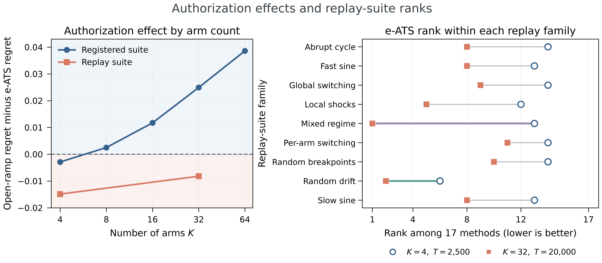
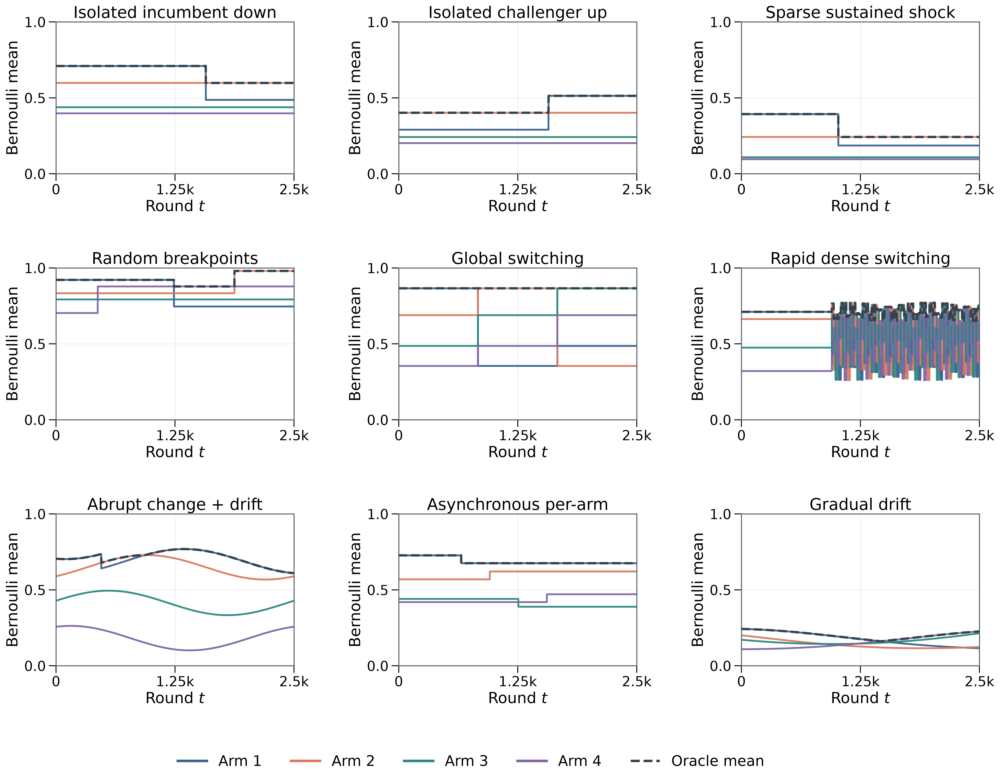
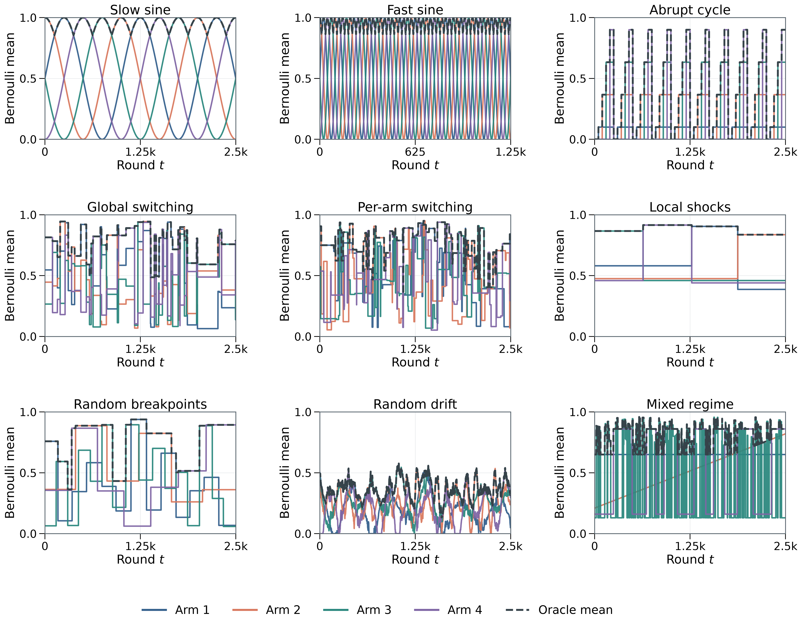

<div align="center">

<h1>When May a Bandit Leave Its Anchor?</h1>
<h3>E-Process-Authorized Thompson Sampling under Non-stationarity</h3>

<p>
  <strong>Mayand Gulati<sup>1</sup> &nbsp;·&nbsp; Kerong Wang<sup>1</sup> &nbsp;·&nbsp; Wei-Chen Au<sup>2</sup></strong><br>
  <sup>1</sup>UC Santa Barbara &nbsp;&nbsp; <sup>2</sup>Purdue University
</p>

<p>
  <strong><a href="https://e-values-workshop.github.io/">NeurIPS 2026 Workshop · E-Values: From Statistics to ML</a></strong><br>
  Accepted poster &nbsp;·&nbsp; <a href="https://neurips.cc/virtual/2026/loc/paris/workshop/137611">Official NeurIPS workshop page</a>
</p>

<p>
  <a href="https://arxiv.org/abs/2610.03646"></a>
  <a href="https://arxiv.org/pdf/2610.03646"></a>
  <a href="LICENSE"></a>
</p>

<p>
  <a href="#overview">Overview</a> &nbsp;·&nbsp;
  <a href="#results">Results</a> &nbsp;·&nbsp;
  <a href="#installation">Installation</a> &nbsp;·&nbsp;
  <a href="#reproduction">Reproduction</a> &nbsp;·&nbsp;
  <a href="#citation">Citation</a>
</p>

</div>

## Overview

**e-ATS** asks when a bandit should start forgetting. It follows optimistic
Thompson sampling (OTS) until an arm's e-process authorizes adaptation, then
uses a relevance score to mix full-history and discounted estimates. Under an
independent per-arm Beta(1,1)–Bernoulli prior-predictive stationary model, the probability of ever
departing from OTS is at most the chosen error budget, α_E.

This repository contains the code, saved results, and manuscript for our
[paper](https://arxiv.org/abs/2610.03646). This is designed so you can recompute its tables and
confidence intervals from the saved runs or execute the experiments.

## Results

<p align="center">
  <a href="paper/figures/authorization_and_rank_summary.png"></a>
</p>

*Left: open-ramp regret minus e-ATS regret; positive values favor e-ATS.
Right: e-ATS ranks among 17 methods; lower is better.*

Removing authorization increased mean regret by **38.4% on the registered
suite** but reduced it by **7.5% on replay**, relative to e-ATS. So, from our 
results authorization helps in some environments and costs performance in others.

| Policy | Registered nonstationary | Replay |
|---|---:|---:|
| OTS | 0.0494 | 0.2157 |
| Open ramp | 0.0540 | 0.1414 |
| **e-ATS** | **0.0390** | **0.1530** |
| Certified GLR | 0.0418 | 0.1750 |
| Practical GLR | 0.0392 | 0.1529 |

Values are mean normalized dynamic pseudo-regret (lower is better). The two
suites use different environments, so compare policies within each column.

Across the 18 replay cells, e-ATS has mean rank **9.72: 12th of 17 by mean
rank, and 13th by mean regret**.

SW-UCB has the lowest overall mean regret. Its selected window is τ=T, so it
uses the full history in these experiments; D-UCB's discount also gives a
memory scale of T. See [baseline settings](docs/ALGORITHMS.md#ucb-memory-settings).

### Strongest replay results

Notably, at **K=32, T=20,000**, e-ATS ranks **first in mixed regime** and **second in
random drift** among the 17 methods:

| Environment | e-ATS rank | e-ATS regret | Best baseline: SW-UCB | Open ramp |
|---|---:|---:|---:|---:|
| Mixed regime | **1st / 17** | **0.0996** | 0.1032 | 0.1084 |
| Random drift | **2nd / 17** | **0.0842** | 0.0802 | 0.0750 |

Mixed regime combines stable, drifting, bursty, and switching arms and Random
drift uses oscillating arm means with changing amplitudes and trends.
e-ATS beats both SW-UCB and the open ramp in mixed regime. In random drift,
SW-UCB is the only literature baseline ahead of e-ATS, while the open ramp
also achieves lower regret.

Each value averages 50 mean trajectories with five paired runs each. Ranks
compare e-ATS with the 16 literature baselines; the open-ramp ablation is
shown separately and is not included in those ranks.

### Registered and replay suites

| Suite | Purpose | Size |
|---|---|---|
| **Registered** | Isolate the effect of authorization across 20 arm-count/horizon combinations | 16,380 random nonstationary, 1,820 stationary, and 5,400 stress groups |
| **Replay** | Compare with 16 baselines on nine established environment families at K=4 and K=32 | 4,500 groups on 606 distinct mean trajectories |

The registered primary result uses the random nonstationary groups. 
Note that stress and stationary results are reported separately.

<details>
<summary><strong>Environment examples</strong></summary>

**Registered suite** — nine mechanisms at K=4, T=2,500. Colors show arm means;
the dashed line shows the best available mean. These examples are separate
from the evaluation groups.



**Replay suite** — nine families at K=4, T=2,500, seed 1,840,201. The fast-sine
panel shows the first 1,250 rounds.



</details>

## Installation

Use **Python 3.12.13**. From the repository root:

```sh
python3.12 -m venv .venv
source .venv/bin/activate
python -m pip install -r requirements.txt
python -m pip install -e '.[test]'
```

On Windows, activate with `.venv\Scripts\activate`. If you need the pinned
Python version, [uv](https://docs.astral.sh/uv/getting-started/installation/)
can install it: run `uv python install` and `uv venv --managed-python --seed`,
then activate the environment and run the pip commands above. Keep the checkout;
the package reads its bundled data and figures.

## Reproduction

### Recompute the reported results

```sh
python -m eats verify
python -m eats reproduce --bootstrap --no-figures
make test
```

This checks the release, recomputes tables and confidence intervals from the
saved runs using 50,000 bootstrap resamples, and runs the portable tests.
Outputs go to `results/paper/`. Omit `--bootstrap` for a faster summary.
Without `make`, use `python -m pytest -m 'not reference'`.

Saved-result analysis is covered by Linux and macOS CI. **Exact experiment and
figure regeneration is supported on macOS ARM64 with the pinned runtime.**
Linux reruns currently encounter mean-table mismatches. On the reference
platform, omit `--no-figures` to rebuild the figures and use
`make test-reference` for the archived-trajectory tests.

### Run the experiments

On the reference platform, start with a small subset of each suite:

```sh
python -m eats run registered --smoke --workers 4
python -m eats run replay --smoke --workers 4
```

The registered smoke run covers all ten mechanisms; replay covers all nine
families. Both use the original horizons and check the results against the
archive. Repeat a command to resume an interrupted run. Outputs are saved in
`results/<suite>/`; use `python -m eats run --help` for subset and output options.

<details>
<summary><strong>Full experiment commands</strong></summary>

```sh
python -m eats run registered --full --workers 4
python -m eats run replay --full --workers 4
python -m eats run calibration --full --workers 4
python -m eats run registered --full --policies calibrated-glr --workers 4
python -m eats run null --full --workers 4
```

These are substantial CPU jobs. The full registered suite alone has 23,600
groups, horizons up to 160,000, and several billion policy rounds.

</details>

See the [reproduction guide](docs/REPRODUCIBILITY.md) for the paper-to-code map,
statistical procedures, and platform details.

## Code and algorithms

```text
eats/algorithms/     e-ATS, gate comparisons, and literature baselines
eats/environments/   registered and replay generators
eats/experiments/    experiment runners
data/               saved runs, configurations, and small fixtures
paper/              manuscript and figures
provenance/         selection records, protocols, and source hashes
tests/              algorithm and reproduction checks
```

The [algorithm guide](docs/ALGORITHMS.md) lists implementations and settings.
To build the manuscript, install TeX Live with `algorithm` and `algorithmic`,
then run `make paper`. The bundled source includes
[clarifications to arXiv v1](docs/REPRODUCIBILITY.md#relation-to-arxiv-v1).

## How settings were chosen

The 14 tunable baselines were selected per geometry by staged grid search
and validation on the same nine replay families, using seeds disjoint from
replay. TS and OTS used fixed settings. e-ATS inherited its predecessor's
K=32 selection, **(γ,ν,ζ)=(0.995,0.30,0.80)**, at every geometry. Its
authorization threshold **K/α_E was not tuned**. Tuning budgets were not equal.

For the slow, fast, and abrupt families, tuning and replay used the same mean
trajectories; only reward and policy randomness differed. Replay is a
historical comparison, not a new confirmatory benchmark. The
[selection history](docs/REPRODUCIBILITY.md#baseline-selection-and-replay-scope)
and [controller settings](docs/ALGORITHMS.md#origin-of-controller-settings)
give the details and original records.

## Citation

If you use this code or its results, please cite the paper:

```bibtex
@misc{gulati2026eats,
  title         = {When May a Bandit Leave Its Anchor? {E}-Process-Authorized {Thompson} Sampling under Non-stationarity},
  author        = {Mayand Gulati and Kerong Wang and Wei-Chen Au},
  year          = {2026},
  eprint        = {2610.03646},
  archivePrefix = {arXiv},
  primaryClass  = {cs.LG},
  url           = {https://arxiv.org/abs/2610.03646}
}
```

Citation metadata are also available in [CITATION.cff](CITATION.cff).

## License

Code and documentation are [MIT licensed](LICENSE). The manuscript and bundled
LaTeX packages retain their existing rights; see [third-party notices](THIRD_PARTY_NOTICES.md).
